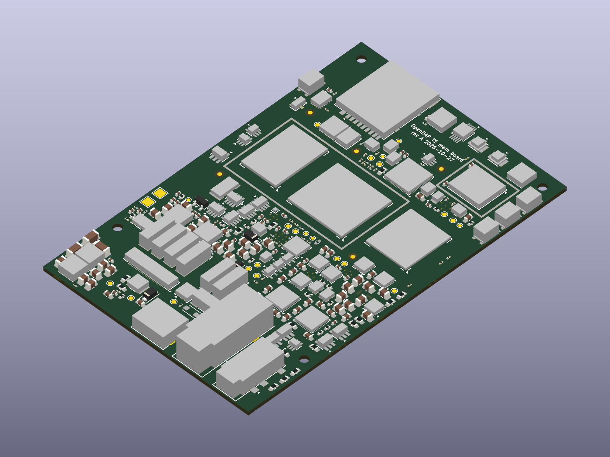

# Outputs

Generated by `odw render update` from `outputs.toml` (RFC 0021); never edited by hand.

## t1-main-board

`hardware/t1-main-board/t1-main-board.kicad_sch` (kicad-sch)

- [`schematic.pdf`](t1-main-board/schematic.pdf)
- [`schematic/3-3-v-system-rail.svg`](t1-main-board/schematic/3-3-v-system-rail.svg)
- [`schematic/3-5-mm-headphone-jack.svg`](t1-main-board/schematic/3-5-mm-headphone-jack.svg)
- [`schematic/3-8-v-pre-regulator.svg`](t1-main-board/schematic/3-8-v-pre-regulator.svg)
- [`schematic/4-4-mm-headphone-jack.svg`](t1-main-board/schematic/4-4-mm-headphone-jack.svg)
- [`schematic/5-1-v-source.svg`](t1-main-board/schematic/5-1-v-source.svg)
- [`schematic/ambient-microphone.svg`](t1-main-board/schematic/ambient-microphone.svg)
- [`schematic/antenna-feeds.svg`](t1-main-board/schematic/antenna-feeds.svg)
- [`schematic/audio-audio-amplifier-rails-amplifier-rails-6-v-ldos.svg`](t1-main-board/schematic/audio-audio-amplifier-rails-amplifier-rails-6-v-ldos.svg)
- [`schematic/audio-audio-amplifier-rails-amplifier-rails-7-v-pre-rails.svg`](t1-main-board/schematic/audio-audio-amplifier-rails-amplifier-rails-7-v-pre-rails.svg)
- [`schematic/audio-audio-amplifier-rails.svg`](t1-main-board/schematic/audio-audio-amplifier-rails.svg)
- [`schematic/audio-audio-balanced-output-stage-balanced-output-stage-left-channel.svg`](t1-main-board/schematic/audio-audio-balanced-output-stage-balanced-output-stage-left-channel.svg)
- [`schematic/audio-audio-balanced-output-stage-balanced-output-stage-right-channel.svg`](t1-main-board/schematic/audio-audio-balanced-output-stage-balanced-output-stage-right-channel.svg)
- [`schematic/audio-audio-balanced-output-stage.svg`](t1-main-board/schematic/audio-audio-balanced-output-stage.svg)
- [`schematic/audio-audio-dac-left.svg`](t1-main-board/schematic/audio-audio-dac-left.svg)
- [`schematic/audio-audio-dac-right.svg`](t1-main-board/schematic/audio-audio-dac-right.svg)
- [`schematic/audio-audio-dac-supplies.svg`](t1-main-board/schematic/audio-audio-dac-supplies.svg)
- [`schematic/audio-audio-master-clocks.svg`](t1-main-board/schematic/audio-audio-master-clocks.svg)
- [`schematic/audio-audio-single-ended-output-stage.svg`](t1-main-board/schematic/audio-audio-single-ended-output-stage.svg)
- [`schematic/audio.svg`](t1-main-board/schematic/audio.svg)
- [`schematic/board-eeprom.svg`](t1-main-board/schematic/board-eeprom.svg)
- [`schematic/charger-and-battery-path-charger-battery-path.svg`](t1-main-board/schematic/charger-and-battery-path-charger-battery-path.svg)
- [`schematic/charger-and-battery-path-charger-bq25798.svg`](t1-main-board/schematic/charger-and-battery-path-charger-bq25798.svg)
- [`schematic/charger-and-battery-path-charger-input-mux.svg`](t1-main-board/schematic/charger-and-battery-path-charger-input-mux.svg)
- [`schematic/charger-and-battery-path.svg`](t1-main-board/schematic/charger-and-battery-path.svg)
- [`schematic/coprocessor-coprocessor-rp2354a.svg`](t1-main-board/schematic/coprocessor-coprocessor-rp2354a.svg)
- [`schematic/coprocessor-coprocessor-supplies.svg`](t1-main-board/schematic/coprocessor-coprocessor-supplies.svg)
- [`schematic/coprocessor.svg`](t1-main-board/schematic/coprocessor.svg)
- [`schematic/cover-detect.svg`](t1-main-board/schematic/cover-detect.svg)
- [`schematic/cpu-core-supply.svg`](t1-main-board/schematic/cpu-core-supply.svg)
- [`schematic/current-monitors.svg`](t1-main-board/schematic/current-monitors.svg)
- [`schematic/emmc-storage.svg`](t1-main-board/schematic/emmc-storage.svg)
- [`schematic/faceplate-backlight.svg`](t1-main-board/schematic/faceplate-backlight.svg)
- [`schematic/faceplate-connector.svg`](t1-main-board/schematic/faceplate-connector.svg)
- [`schematic/faceplate-controls.svg`](t1-main-board/schematic/faceplate-controls.svg)
- [`schematic/faceplate-display-supply.svg`](t1-main-board/schematic/faceplate-display-supply.svg)
- [`schematic/fuel-gauge.svg`](t1-main-board/schematic/fuel-gauge.svg)
- [`schematic/gpio-expander.svg`](t1-main-board/schematic/gpio-expander.svg)
- [`schematic/haptic-driver.svg`](t1-main-board/schematic/haptic-driver.svg)
- [`schematic/hardware-key-holder.svg`](t1-main-board/schematic/hardware-key-holder.svg)
- [`schematic/hat-port-vbus-and-usb-pd.svg`](t1-main-board/schematic/hat-port-vbus-and-usb-pd.svg)
- [`schematic/hat-usb-port.svg`](t1-main-board/schematic/hat-usb-port.svg)
- [`schematic/interconnect-overview.svg`](t1-main-board/schematic/interconnect-overview.svg)
- [`schematic/lpddr4x-memory.svg`](t1-main-board/schematic/lpddr4x-memory.svg)
- [`schematic/main-usb-c-port.svg`](t1-main-board/schematic/main-usb-c-port.svg)
- [`schematic/maskrom-entry.svg`](t1-main-board/schematic/maskrom-entry.svg)
- [`schematic/microphone-supply.svg`](t1-main-board/schematic/microphone-supply.svg)
- [`schematic/microsd-socket.svg`](t1-main-board/schematic/microsd-socket.svg)
- [`schematic/motion-sensor.svg`](t1-main-board/schematic/motion-sensor.svg)
- [`schematic/nfc-tag.svg`](t1-main-board/schematic/nfc-tag.svg)
- [`schematic/pmic.svg`](t1-main-board/schematic/pmic.svg)
- [`schematic/power-overview.svg`](t1-main-board/schematic/power-overview.svg)
- [`schematic/root.svg`](t1-main-board/schematic/root.svg)
- [`schematic/shield-can-frames.svg`](t1-main-board/schematic/shield-can-frames.svg)
- [`schematic/side-buttons.svg`](t1-main-board/schematic/side-buttons.svg)
- [`schematic/soc-soc-ground.svg`](t1-main-board/schematic/soc-soc-ground.svg)
- [`schematic/soc-soc-lpddr4x-interface.svg`](t1-main-board/schematic/soc-soc-lpddr4x-interface.svg)
- [`schematic/soc-soc-pmu-io-domains-clock-reset-and-saradc.svg`](t1-main-board/schematic/soc-soc-pmu-io-domains-clock-reset-and-saradc.svg)
- [`schematic/soc-soc-supplies-and-decoupling.svg`](t1-main-board/schematic/soc-soc-supplies-and-decoupling.svg)
- [`schematic/soc-soc-usb-pcie-mipi-hdmi-and-edp-phys.svg`](t1-main-board/schematic/soc-soc-usb-pcie-mipi-hdmi-and-edp-phys.svg)
- [`schematic/soc-soc-vccio1-to-vccio4.svg`](t1-main-board/schematic/soc-soc-vccio1-to-vccio4.svg)
- [`schematic/soc-soc-vccio5-to-vccio7.svg`](t1-main-board/schematic/soc-soc-vccio5-to-vccio7.svg)
- [`schematic/soc.svg`](t1-main-board/schematic/soc.svg)
- [`schematic/speaker-amplifier.svg`](t1-main-board/schematic/speaker-amplifier.svg)
- [`schematic/status-led-driver.svg`](t1-main-board/schematic/status-led-driver.svg)
- [`schematic/test-and-debug-access.svg`](t1-main-board/schematic/test-and-debug-access.svg)
- [`schematic/usb-c-source-path.svg`](t1-main-board/schematic/usb-c-source-path.svg)
- [`schematic/wi-fi-and-bluetooth-module-radio-module.svg`](t1-main-board/schematic/wi-fi-and-bluetooth-module-radio-module.svg)
- [`schematic/wi-fi-and-bluetooth-module-radio-rails-and-pdn-hold.svg`](t1-main-board/schematic/wi-fi-and-bluetooth-module-radio-rails-and-pdn-hold.svg)
- [`schematic/wi-fi-and-bluetooth-module.svg`](t1-main-board/schematic/wi-fi-and-bluetooth-module.svg)

## t1-main-board-pcb

`hardware/t1-main-board/t1-main-board.kicad_pcb` (kicad-pcb)

- [`pcb/B_Cu.svg`](t1-main-board-pcb/pcb/B_Cu.svg)
- [`pcb/B_Fab.svg`](t1-main-board-pcb/pcb/B_Fab.svg)
- [`pcb/B_Silkscreen.svg`](t1-main-board-pcb/pcb/B_Silkscreen.svg)
- [`pcb/F_Cu.svg`](t1-main-board-pcb/pcb/F_Cu.svg)
- [`pcb/F_Fab.svg`](t1-main-board-pcb/pcb/F_Fab.svg)
- [`pcb/F_Silkscreen.svg`](t1-main-board-pcb/pcb/F_Silkscreen.svg)
- [`pcb/In1_Cu.svg`](t1-main-board-pcb/pcb/In1_Cu.svg)
- [`pcb/In2_Cu.svg`](t1-main-board-pcb/pcb/In2_Cu.svg)
- [`pcb/In3_Cu.svg`](t1-main-board-pcb/pcb/In3_Cu.svg)
- [`pcb/In4_Cu.svg`](t1-main-board-pcb/pcb/In4_Cu.svg)
- [`render/bottom.png`](t1-main-board-pcb/render/bottom.png)
- [`render/iso-back.png`](t1-main-board-pcb/render/iso-back.png)
- [`render/iso-front.png`](t1-main-board-pcb/render/iso-front.png)
- [`render/top.png`](t1-main-board-pcb/render/top.png)
